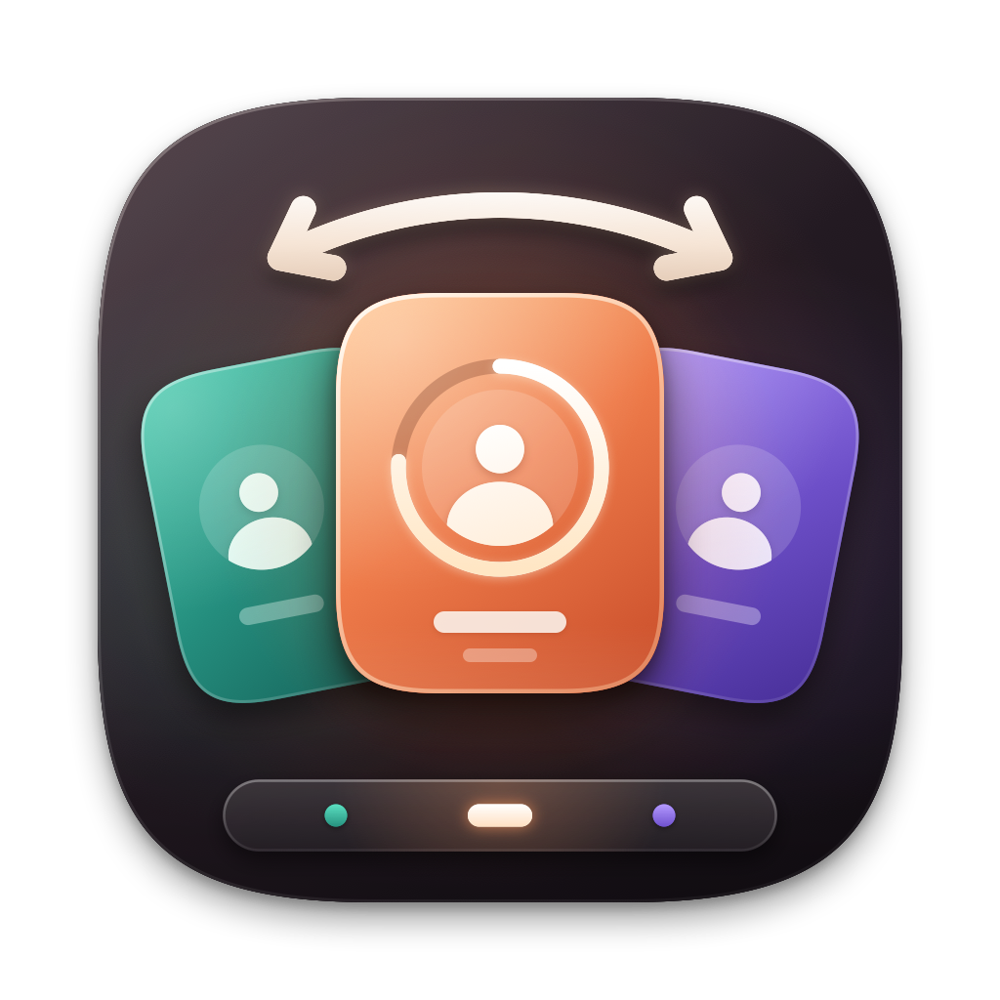
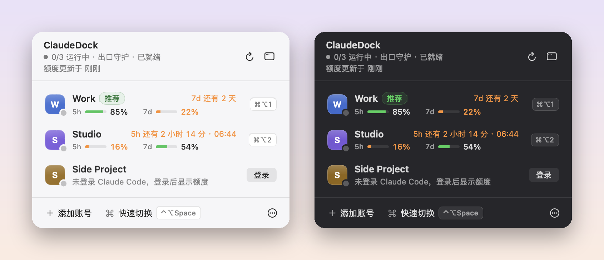

<p align="center">
  
</p>

<h1 align="center">ClaudeDock</h1>

<p align="center">
  Keep one official Claude Desktop window open per account on macOS, watch remaining quota in the menu bar, and jump with a keystroke.
</p>

<p align="center">
  <a href="https://github.com/designfuchen/ClaudeDock/releases/latest"></a>
  <a href="https://github.com/designfuchen/ClaudeDock/releases"></a>
  
  
  
  <a href="LICENSE"></a>
</p>

<p align="center">
  <strong>English</strong> · <a href="README_ZH.md">简体中文</a>
</p>

<p align="center">
  <a href="#install">Install</a> ·
  <a href="#what-it-does">Features</a> ·
  <a href="#privacy--permissions">Privacy &amp; permissions</a> ·
  <a href="#faq">FAQ</a> ·
  <a href="#cli">CLI</a>
</p>

<p align="center">
  
</p>

## Why I built this

I use different Claude accounts for different projects. Signing out of Desktop just to open the next project got old. When I hit a limit halfway through a Claude Code session, I wanted to know which account had room to finish it. I built ClaudeDock so I could pick that account from the menu bar and keep my place.

## Install

You need **macOS 14 or later** and **Claude Desktop**. Install **Claude Code** if you want quota readouts or the Projects view.

- **[Download the latest `.dmg`](https://github.com/designfuchen/ClaudeDock/releases/latest)** (~8 MB, Swift 6 + SwiftUI, zero third-party dependencies) and drag `ClaudeDock.app` into `/Applications`. I sign the app with a Developer ID and have it notarized by Apple, so it opens without a Gatekeeper warning and a copy you have downloaded keeps working.
- **Homebrew:**

  ```bash
  brew tap designfuchen/tap
  brew trust designfuchen/tap   # Homebrew 7+ asks you to trust third-party taps once
  brew install --cask claudedock
  ```

  This also links the `claudedock` CLI. `brew uninstall --zap --cask claudedock` removes the app and `~/.claudedock`.
- **From source:** see [Build from source](#build-from-source).

> The app speaks English and Simplified Chinese and follows your system language. To pick one just for ClaudeDock: System Settings → General → Language & Region → Applications.

## What it does

### 1. One official Desktop window per account

Each Pro or Max account gets its own official Claude Desktop window, and they can all stay open at once. ClaudeDock launches the stock `Claude.app` with a separate `--user-data-dir` for each account—it never copies or modifies the app bundle. Close the main window and ClaudeDock stays out of the Dock, running from the menu bar.

Jump straight to any account with <kbd>⌘</kbd><kbd>⌥</kbd><kbd>1</kbd>–<kbd>9</kbd>, pick one from the menu bar switcher, or hit <kbd>⌃</kbd><kbd>⌥</kbd><kbd>Space</kbd> for a quick switcher with pinyin search across accounts and projects.

| Shortcut | Action |
| :--- | :--- |
| <kbd>⌘</kbd><kbd>⌥</kbd><kbd>1</kbd>–<kbd>9</kbd> | Focus account 1–9's Claude Desktop window |
| <kbd>⌃</kbd><kbd>⌥</kbd><kbd>Space</kbd> | Open the quick switcher (accounts & projects, pinyin search) |

### 2. Remaining 5-hour and 7-day quota, without spending tokens

The menu bar switcher shows how much quota is *left* for each account—labels read like `Work · 82% left` (`Work · 剩 82%` in the current Chinese UI)—along with reset times (`in 29 min · 16:00 local`) and freshness stamps (`updated 3 min ago`). A window past its reset time shows `pending refresh` until it is re-read, rather than stale usage.

ClaudeDock reads quota through Claude Code's own usage query without spending tokens. It recommends the account with the most headroom and warns you before the active one runs dry.


### 3. Pick up any Claude Code project from any account

The **Projects** view lists every Claude Code project and session on your Mac. Click **Continue** to jump right back to that account's Claude Desktop window, or continue the session in Terminal with whichever account has room. Turn on shared Claude Code history and your transcripts move across accounts while each account's login stays separate. Migration backs up your existing folders and copies the files—it never deletes them.


### 4. MCP and local skills synced across accounts

Add an MCP server in one Desktop account and ClaudeDock syncs it to the others using a three-way merge, with a backup before every write. Local Claude Code skills, agents, and commands are shared across accounts as well.

### 5. Network and egress consistency checks

Set an exit rule (IP, country, region, or timezone) for an account. Before launching its window—and periodically while it runs—ClaudeDock verifies the proxy's real exit against your rule. If a switched node or dropped tunnel causes the exit to drift, ClaudeDock pauses that account until a re-check passes. If you use Clash Verge Rev, the optional multi-port helper generates a Merge config so each account can use its own port and node.


## Is this for you?

If you pay for two or more official Claude Pro or Max accounts and spend your day in Claude Desktop and Claude Code on macOS, this is what I built ClaudeDock for.

Depending on your setup, there are great tools built for adjacent workflows:

- Switching between API providers, relays, or multiple coding CLIs? **[CC Switch](https://github.com/farion1231/cc-switch)** is built for that.
- Tracking quotas and spend across dozens of coding services (Codex, Cursor, OpenRouter, and more) in your menu bar? **[CodexBar](https://github.com/steipete/CodexBar)** is great for that.
- Running multiple **official Claude accounts side-by-side**—keeping every Desktop window open, switching with a hotkey, resuming a Claude Code session on whichever account has headroom, syncing MCP configs, and checking proxy exits? That's **ClaudeDock**.

## Quick start

1. Open ClaudeDock and add an account for each Desktop login. If an account needs a specific proxy exit, set its rule before opening the window.
2. Open each account and sign in once. The sign-in assistant temporarily closes other Claude windows so the browser callback reaches the right one, then reopens them.
3. Leave the windows open. Press <kbd>⌘</kbd><kbd>⌥</kbd><kbd>1</kbd>–<kbd>9</kbd> to jump between them, or pick an account by remaining quota in the menu bar. To continue a Claude Code session under another account, enable shared history in **Projects** and pick the account to resume with.

## Privacy & permissions

- **No telemetry.** Apart from Claude's own traffic, nothing leaves your Mac except the optional exit check: an HTTPS request sent through your proxy to a public IP lookup service (`ipinfo.io`, `ipwho.is`, or `ifconfig.co`).
- **Local storage and isolation.** ClaudeDock profiles are stored under `~/.claudedock` with `0600` permissions so only your macOS user can read or write them. Per-account Claude Code logins live under `~/.claudedock/cli-profiles/<account id>`, and each account's Desktop data lives under `~/Library/Application Support/Claude-<name>`. Sharing Claude Code history never shares credentials.
- **Untouched `Claude.app`.** ClaudeDock never patches, wraps, or copies `Claude.app`. Isolation comes purely from `--user-data-dir`.
- **The exit check is not a firewall.** ClaudeDock checks before launch and periodically afterward. If the exit changes between checks, traffic can briefly use the new exit before ClaudeDock catches it and pauses the account.
- **Minimal macOS permissions.** ClaudeDock asks for **no Accessibility**, **no Screen Recording**, and **no Full Disk Access**. Notifications are optional (used for low-quota and exit-drift alerts). Global hotkeys use Carbon `RegisterEventHotKey`, which requires no permission prompt.

## FAQ

**Does ClaudeDock modify `Claude.app`?**  
No. It launches your existing official `Claude.app` with a separate `--user-data-dir` flag for each account. The app bundle is never modified or copied.

**Does reading quota cost tokens?**  
No. ClaudeDock reads 5-hour and 7-day remaining quota through Claude Code's own usage query, without sending prompts or spending tokens.

**What macOS permissions does it need?**  
None are required to run. No Accessibility, no Screen Recording, and no Full Disk Access. Notifications are optional, and global hotkeys register via Carbon `RegisterEventHotKey` without triggering a system prompt.

**Can I resume a Desktop chat with another account?**  
No. Desktop chats live on Anthropic's servers under the account that started them. Cross-account resume works for Claude Code sessions because their history is stored locally on your Mac.

**What happens to my existing Claude Code history?**  
When you enable shared history, ClaudeDock backs up your existing folders and copies the files. It never deletes them. Each account keeps its own Claude Code login under `~/.claudedock/cli-profiles/<account id>`, even if you rename the account in ClaudeDock.

**Do skills I uploaded to claude.ai sync too?**  
No. Those belong to the account you uploaded them to. Local Claude Code skills, agents, and commands are what get shared.

**Can I use ClaudeDock without Claude Code or Clash Verge Rev?**  
Yes. Without Claude Code you still get separate Desktop windows, hotkey switching, MCP sync, and exit checks—you just won't get quota meters or the Projects view. Clash Verge Rev is optional even for exit checks: point an account at any HTTP proxy, or leave exit checks off.

**How do I uninstall it, and will it delete my accounts?**  
Removing `ClaudeDock.app` leaves all of your Claude Desktop account folders intact. See [Uninstall](#uninstall) for the exact paths and commands.

## CLI

The companion `claudedock` CLI ships inside the app bundle. Link it once if `~/.local/bin` is on your `PATH`:

```bash
mkdir -p ~/.local/bin
ln -sf /Applications/ClaudeDock.app/Contents/MacOS/claudedock ~/.local/bin/claudedock
```

A few everyday commands:

```bash
claudedock add Work --pin       # Add an account pinned to your local proxy's current exit
claudedock open Work            # Check exit rule and open/focus the Desktop window
claudedock quota                # Show remaining 5h/7d quota for every account
claudedock sync mcp             # Three-way merge Desktop MCP servers across accounts
claudedock projects             # List Claude Code projects and sessions across accounts
```

See [docs/cli.md](docs/cli.md) for the full command reference, flags, JSON output, Clash helpers, and update guard.

## Build from source

You need macOS 14+ and a Swift 6 toolchain. The build fetches no external packages.

```bash
git clone https://github.com/designfuchen/ClaudeDock.git
cd ClaudeDock
swift build                 # Build the package and CLI
bash scripts/build-app.sh   # Package ClaudeDock.app
```

## Uninstall

Quit ClaudeDock and remove the app bundle:

```bash
osascript -e 'quit app "ClaudeDock"'
rm -rf /Applications/ClaudeDock.app
```

Optionally remove ClaudeDock's config, per-account CLI login profiles, and helper symlinks:

```bash
rm -rf ~/.claudedock
rm -f ~/.local/bin/claudedock
find ~/.local/bin -lname "$HOME/.claudedock/bin/*" -delete   # only the claude-<account> links ClaudeDock created
```

Your per-account Claude Desktop data folders live at `~/Library/Application Support/Claude-<name>` (one folder per account). They are never deleted automatically—remove them manually only if you also want to clear those Desktop logins and local caches.

## License & feedback

[MIT](LICENSE). ClaudeDock is an independent project, not affiliated with or endorsed by Anthropic. Claude is a trademark of Anthropic, PBC.

I maintain this solo—if you hit a bug or want to talk through an idea, please [open an issue](https://github.com/designfuchen/ClaudeDock/issues) (and check in there first before putting time into a large PR).
