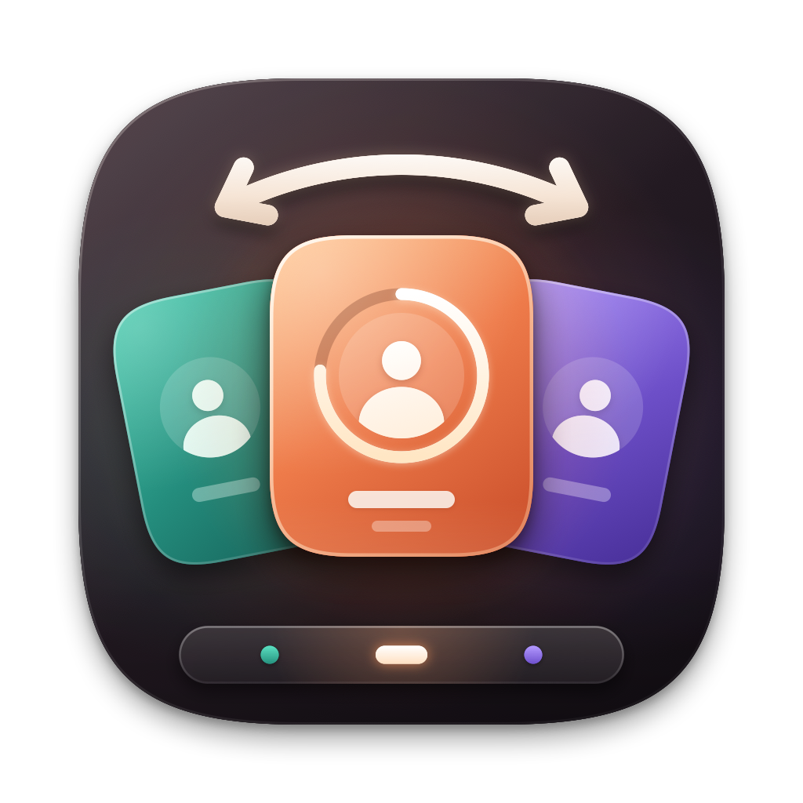
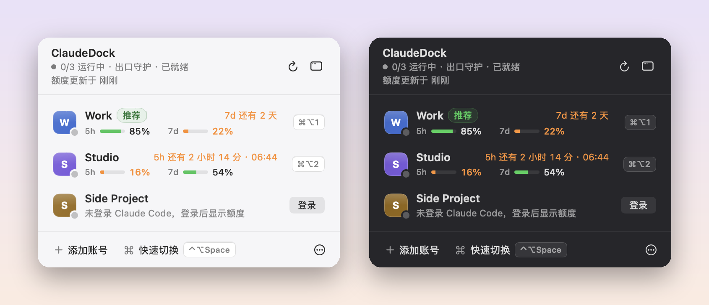
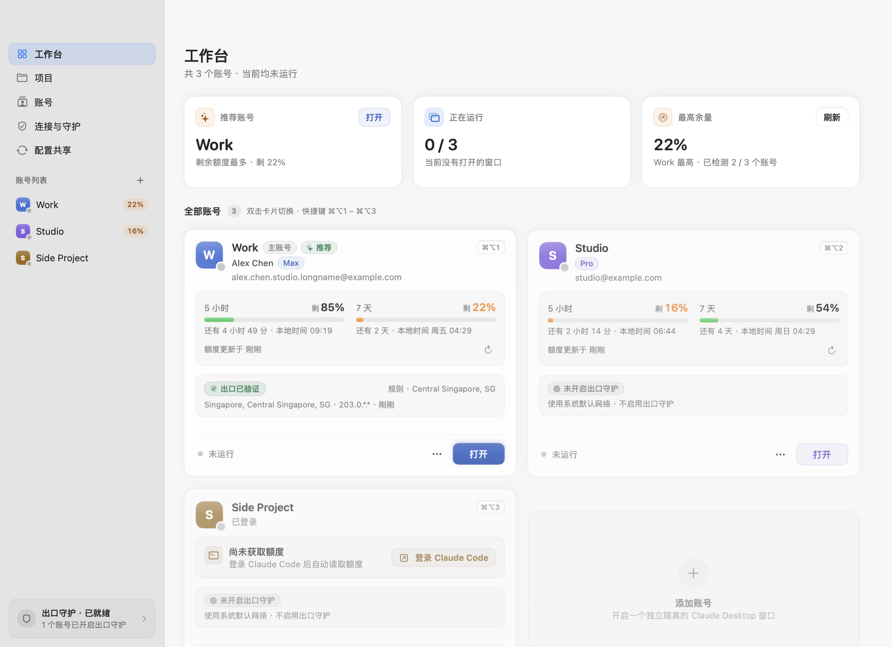

<p align="center">
  
</p>

<h1 align="center">ClaudeDock</h1>

<p align="center">
  在 Mac 上同时开多个官方 Claude Desktop 窗口，一眼看清剩余额度，按快捷键直接切过去。
</p>

<p align="center">
  <a href="https://github.com/designfuchen/ClaudeDock/releases/latest"></a>
  <a href="https://github.com/designfuchen/ClaudeDock/releases"></a>
  
  
  
  <a href="LICENSE"></a>
</p>

<p align="center">
  <a href="README.md">English</a> · <strong>简体中文</strong>
  <br>
  <a href="#安装">安装</a> · <a href="#核心功能">核心功能</a> · <a href="#隐私与权限">隐私与权限</a> · <a href="#常见问题">常见问题</a> · <a href="#命令行工具">CLI</a>
</p>

<p align="center">
  
</p>

## 我为什么写这个工具

我付了好几个官方 Claude 账号的钱，每天大部分时间都在 Mac 的 Claude Desktop 和 Claude Code 里干活。为了开下一个项目，天天在 Desktop 里登出再登录，实在受够了，自己拼的一堆脚本也动不动就散架。最烦的是写代码写到一半撞上 5 小时或 7 天上限，根本不知道哪个号还剩多少，换个号还得重新折腾一遍 MCP 和会话；代理节点偶尔切错，出口悄悄漂了也挺麻烦。干脆自己写了个原生 Mac 工具，把这些事全收进菜单栏。

## 安装

需要 macOS 14+，且本机已安装官方 Claude Desktop。Claude Code 是可选的（仅额度读取和跨账号项目列表需要）。

界面支持简体中文和英文，跟随系统语言。想单独给 ClaudeDock 指定语言：系统设置 → 通用 → 语言与地区 → 应用程序。

- **直接下载安装包**：去 [Releases 下载最新 `.dmg`](https://github.com/designfuchen/ClaudeDock/releases/latest)，把 `ClaudeDock.app` 拖进「应用程序」即可。
  - 原生 Swift 6 + SwiftUI 编写，零第三方依赖，安装包约 8 MB。
  - 已使用我的 Apple Developer ID 签名并通过 Apple 公证——打开不会弹 Gatekeeper 警告，下到本地后可以一直稳稳用下去。
- **Homebrew Cask**：即将上线。
- **自己编译**：见下文 [从源码构建](#从源码构建)。

## 核心功能

### 1. 多个官方窗口并排跑，快捷键直接切

每个账号通过独立的 `--user-data-dir` 启动官方原版 `Claude.app`，既不修改也不复制客户端本体。几个号可以同时开着干活，按 <kbd>⌘</kbd><kbd>⌥</kbd><kbd>1</kbd>–<kbd>9</kbd> 直接跳到对应窗口，或者按 <kbd>⌃</kbd><kbd>⌥</kbd><kbd>Space</kbd> 呼出快速切换面板（支持拼音搜索账号和项目）。菜单栏会直接显示当前账号和剩余额度（例如 `Work · 剩 82%`），关掉主窗口还能隐藏程序坞图标，安静待在右上角。登录新号时，内置的登录助手会先暂时收起其他窗口，免得浏览器回调跳错窗。



### 2. 5 小时 / 7 天剩余额度一眼看清（不耗 token）

直接走 Claude Code 自带的用量查询接口读取每个账号的 5 小时和 7 天剩余额度，不消耗任何 token。每个周期都会标出重置时间（例如 `29 分钟后 · 16:00`）和刷新时间戳（如 `3 分钟前更新`）；如果某个窗口已经过了重置点但还没重新读取，会显示 `待刷新` 而不是拿旧数字凑数。余量最足的账号会自动推荐，手头这个快见底之前也会提醒你换号。



### 3. Projects 视图：所有 Claude Code 项目换号接着干

自动列出这台 Mac 上所有账号的 Claude Code 项目和会话。点「继续」可以直接跳回那个账号的 Claude Desktop 窗口，也可以选任意一个还有余量的账号在终端里接着跑。开启共享历史后，所有账号共用会话记录，但各账号的登录凭据依然各自存放在 `~/.claudedock/cli-profiles/<account id>`；迁移历史时会先完整备份再复制，不删任何原数据。


### 4. MCP 配置与本地 Skills 跨号同步

Claude Desktop 的 MCP 服务器配置支持跨账号三路合并同步，每次写入前都会自动备份，不用每个账号手工改一遍。本机的 Claude Code `skills`、`agents`、`commands` 也在所有账号间共享。

### 5. 代理出口一致性检查

如果你习惯给不同账号固定各自的代理线路，ClaudeDock 会在启动窗口前和运行期间按你设定的规则核对实际出口（IP、国家/地区、时区，不预设任何默认地区）。一旦运行中出口漂移（切错了节点或代理断了），下一次检查会先暂停（`SIGSTOP`）该账号进程，直到重新核对通过再恢复（`SIGCONT`）。如果你也在用 Clash Verge Rev，还自带多端口配置辅助。

| 快捷键 | 作用 |
| :--- | :--- |
| <kbd>⌘</kbd><kbd>⌥</kbd><kbd>1</kbd>–<kbd>9</kbd> | 打开或直接切到对应编号的账号窗口 |
| <kbd>⌃</kbd><kbd>⌥</kbd><kbd>Space</kbd> | 呼出快速切换面板，支持拼音搜索账号与项目 |

## 适合你吗

如果你同时付了两个以上官方 Claude Pro/Max 账号，平时主力在 macOS 上用 Claude Desktop 和 Claude Code，ClaudeDock 就是为你（也是为我自己）写的。

如果你的场景更偏下面两种，社区里已经有非常好的工具：

- 主要是在多家 API 服务商、中转站之间切换，或同时管十几款编程客户端：用 **[CC Switch](https://github.com/farion1231/cc-switch)** 更合适，它专门处理跨工具配置和 API 路由。
- 想在菜单栏统一盯几十家平台（Codex、Cursor、OpenRouter 等）的额度、重置倒计时和账单：可以看看 **[CodexBar](https://github.com/steipete/CodexBar)**。
- 想让**多个官方 Claude 账号在 Mac 上同时开着干活**——快捷键切窗口、看完余量换号接力 Claude Code、跨号同步 MCP、顺便守住每个号的代理出口一致性：这就是 **ClaudeDock** 专注解决的事。

## 快速上手

1. 打开 ClaudeDock，添加你的账号（也可以在终端跑 `claudedock add <名称>`），按需配上代理和出口规则。
2. 从菜单栏、工作台或按 <kbd>⌘</kbd><kbd>⌥</kbd><kbd>1</kbd>–<kbd>9</kbd> 打开各个账号的 Claude Desktop 窗口，分别登录一次。
3. 想跨号接力 Claude Code 会话，到 Projects 页面开启共享历史；想共用一套 Desktop MCP 服务器，在应用里点同步或跑 `claudedock sync mcp` 即可。

## 隐私与权限

- **无遥测，零后端**：不收集任何使用数据，也没有第三方依赖。账号的姓名和邮箱直接从本机 Claude Desktop 缓存读取。
- **网络流量透明**：除了 Claude 自己的流量外，ClaudeDock 唯一会主动发出的网络请求是可选的出口检查——通过你为该账号配的代理发起 HTTPS 请求，查询公开 IP 接口（`ipinfo.io`、`ipwho.is`、`ifconfig.co`）。
- **本地存储与不改本体**：
  - 账号配置以 `0600` 权限存放在 `~/.claudedock`。
  - 各账号的 Claude Code 登录态独立存放在 `~/.claudedock/cli-profiles/<account id>`。
  - 各账号的 Claude Desktop 数据独立存放在 `~/Library/Application Support/Claude-<名称>`。
  - 不修改也不注入 `Claude.app`。
- **macOS 系统权限**：不需要辅助功能（Accessibility）、不需要屏幕录制（Screen Recording）、不需要完全磁盘访问权限（Full Disk Access）。系统通知是可选的；全局快捷键通过 Carbon `RegisterEventHotKey` 注册，不会弹权限请求框。
- **关于出口检查的边界**：出口检查不是防火墙。它的机制是启动前检查加运行时定时探测——如果两次探测之间代理节点切走了，中间会有一小段窗口期，进程会在下一次探测发现漂移时被暂停（`SIGSTOP`），直到复检通过才会恢复。

## 常见问题

**会修改 `Claude.app` 吗？官方客户端更新了怎么办？**
不会。每个账号只是带着独立的 `--user-data-dir` 启动原版 `Claude.app`。官方客户端要更新时，先跑 `claudedock update-guard start`，等它更完再跑 `claudedock update-guard restore` 就能把窗口恢复回来。

**自动读取和刷新额度会消耗 token 吗？**
不会。额度走的是 Claude Code 自带的用量查询接口，不会发对话，也不消耗任何 token。

**需要开哪些 macOS 系统权限？**
不需要辅助功能、屏幕录制或完全磁盘访问权限。全局快捷键使用 Carbon `RegisterEventHotKey` 注册，不会弹隐私授权框；只有通知权限是可选的，用来在额度快见底或出口漂移时提醒你。

**能把 Claude Desktop 里的聊天记录搬到另一个账号吗？**
不能。Claude Desktop 的对话存在 Anthropic 服务器上并绑定各自账号，没法跨号合并或迁移。只有保存在本机的 Claude Code 会话可以跨账号共享和继续。

**不装 Claude Code 或不用 Clash Verge Rev 也能用吗？**
可以，两者都是可选的。没装 Claude Code 时，多开、快捷键切换、MCP 同步和出口检查都能正常用，只是没有额度显示和 Projects 页面。不用 Clash Verge Rev 可以关掉出口检查，或者填任意 HTTP 代理地址。

**开启 Claude Code 共享历史会覆盖我原来的记录吗？**
不会。迁移时会先完整备份原目录再复制，不删任何已有数据。各账号的登录凭据存在独立的 `~/.claudedock/cli-profiles/<account id>` 下，重命名账号也不会打散。

**卸载会不会把我的账号数据一起删掉？**
不会。删除 `ClaudeDock.app` 不会动任何本地数据；如果你想连配置或某个账号的 Desktop 数据一起清理，见下文 [卸载](#卸载) 里的对应命令。

## 命令行工具

如果你习惯在终端操作，可以把内置的 `claudedock` CLI 软链进 PATH：

```bash
mkdir -p ~/.local/bin && ln -sf /Applications/ClaudeDock.app/Contents/MacOS/claudedock ~/.local/bin/claudedock
```

常用命令示例：

```bash
claudedock list                    # 查看所有账号状态
claudedock open <名称>             # 校验出口后打开或聚焦对应窗口
claudedock quota                   # 零 token 查询各账号 5h/7d 剩余额度
claudedock projects                # 列出本机所有 Claude Code 项目与会话
claudedock sync mcp                # 跨账号三路合并 Desktop MCP 配置
```

完整命令列表、参数说明和 `--json` 输出见 [docs/cli.md](docs/cli.md)。

## 从源码构建

需要 macOS 14+ 和 Swift 6 工具链，没有外部依赖要下载。

```bash
# 编译 Swift 包和 CLI
swift build

# 打包原生 .app
bash scripts/build-app.sh
```

## 卸载

退出 ClaudeDock 后删除应用本体：

```bash
osascript -e 'quit app "ClaudeDock"' 2>/dev/null || true
rm -rf /Applications/ClaudeDock.app
```

如果还想一并清理 ClaudeDock 的配置文件、CLI 软链和包装脚本（可选）：

```bash
rm -rf ~/.claudedock
rm -f ~/.local/bin/claudedock
find ~/.local/bin -lname "$HOME/.claudedock/bin/*" -delete   # 只删除 ClaudeDock 创建的 claude-<账号> 链接
```

各账号的官方 Claude Desktop 本地数据保存在下面的目录中，不会被自动删除：

```text
~/Library/Application Support/Claude-<名称>
```

确认不再需要某个账号的本地缓存和登录状态时，手动删掉对应文件夹即可。

## 开源协议与反馈

MIT License，见 [LICENSE](LICENSE)。

这是我业余维护的个人项目，遇到 Bug 或有想法欢迎直接开 [Issue](https://github.com/designfuchen/ClaudeDock/issues)。如果你打算提改动较大的 PR，麻烦先开个 Issue 聊一下方案，省得白费工夫。

---

ClaudeDock 是独立的开源项目，与 Anthropic 没有关联，也未获其背书。Claude 是 Anthropic, PBC 的商标。
